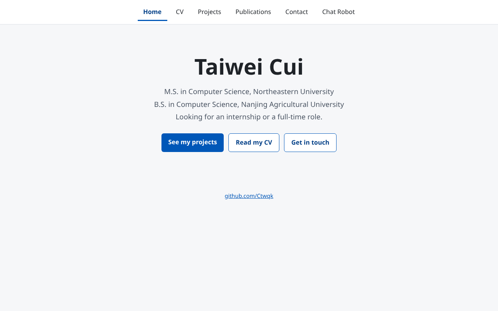
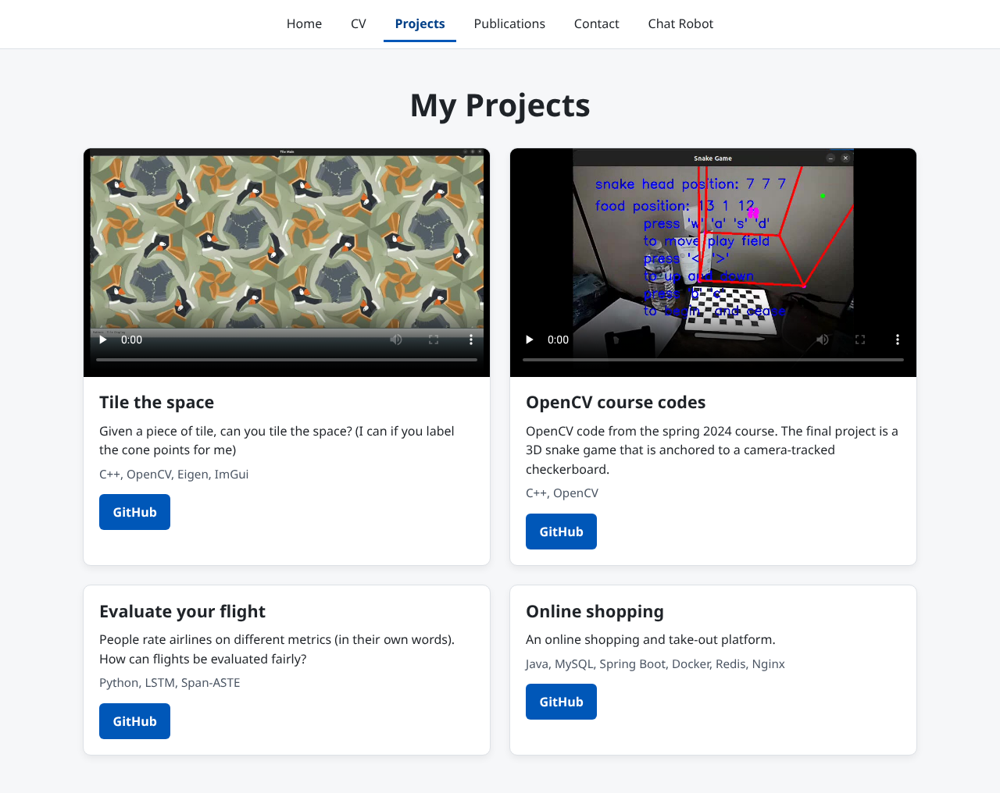
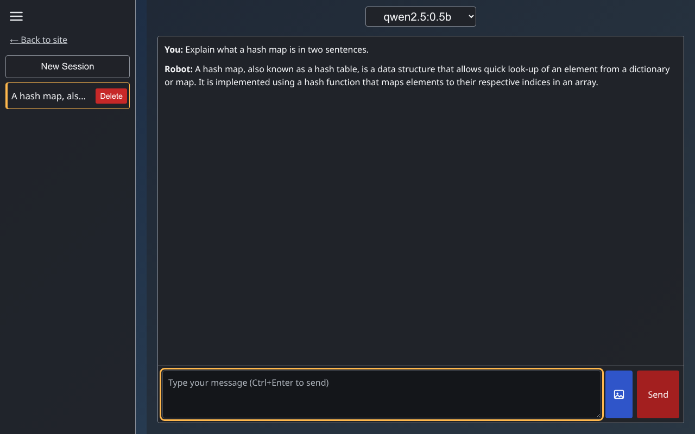
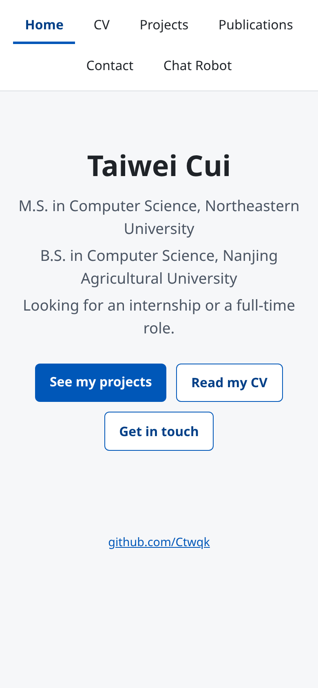
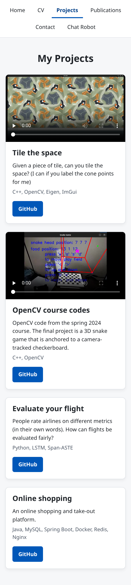
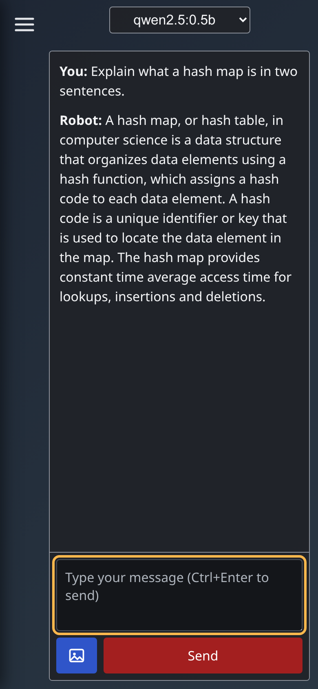
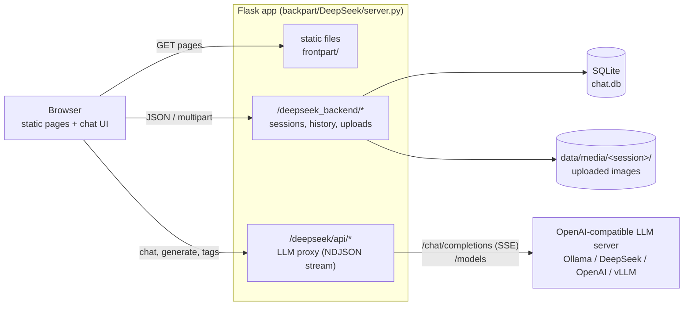

# mypage

[](https://github.com/Ctwqk/mypage/actions/workflows/ci.yml)

Personal site of Taiwei Cui: a small static portfolio (home, CV, projects, publications, contact) plus a **chat page backed by a Flask + SQLite service** that stores sessions and image attachments and streams answers from any OpenAI-compatible LLM (Ollama, the DeepSeek API, OpenAI, ...).

| Home | Projects | Chat |
| --- | --- | --- |
|  |  |  |

<p>
  
  
  
</p>

The chat screenshots were taken against a local Ollama running `qwen2.5:0.5b` (a tiny model, so the answer quality is what you would expect); everything else is the real site.

## Features

- **Static site** (plain HTML/CSS, no build step): responsive layout, one shared stylesheet, semantic landmarks, skip links, keyboard-friendly navigation, `axe-core` clean on every page at desktop and mobile widths.
- **Projects page** with two screen recordings (re-encoded to VP9, 3.8 MB and 2.6 MB, lazy-loaded with posters) and links to the GitHub repositories.
- **Chat page**
  - persistent sessions (create, switch, delete, auto-title from the first message)
  - streamed answers; `<think>...</think>` reasoning is rendered in a muted style (also for models that report reasoning through `reasoning` / `reasoning_content` deltas)
  - up to four image attachments per message (png, jpeg, gif, webp), forwarded to vision models as OpenAI `image_url` parts
  - all model output and stored history is HTML-escaped before it is rendered
  - model picker populated from the LLM server's `/models` list
- **Flask backend** (`backpart/DeepSeek/`): configuration through environment variables only (no secrets in the repo), strict request validation, upload size/type limits (type decided from magic bytes, not from the file name), JSON errors, and a built-in static file server so one process runs the whole site.

## Architecture



The browser only talks to Flask. `server.py` translates between the small Ollama-style streaming protocol the chat UI uses (`{"message": {"content": ...}}` per line) and the OpenAI wire format spoken by the upstream model server, so switching from a local Ollama to a hosted API is a change of environment variables.

## Tech stack

Python 3.10+, Flask 3, SQLite, `requests` · plain HTML/CSS/JavaScript (no framework, no bundler) · pytest + `responses` · ruff · html-validate · Node's built-in test runner · GitHub Actions · Playwright (screenshots only).

## Quickstart

Requirements: Python 3.10+ and an LLM endpoint. The easiest is [Ollama](https://ollama.com) (`ollama pull qwen2.5:0.5b`, or any other model); no model at all is needed if you use the bundled stub (below).

```bash
cd backpart/DeepSeek
python3 -m venv .venv && source .venv/bin/activate
pip install -r requirements.txt

# Ollama on its default port is the default upstream. The model list in the UI comes from the server;
# LLM_MODEL is only the fallback for title generation / when the list cannot be fetched.
LLM_MODEL=qwen2.5:0.5b python server.py
```

Open <http://127.0.0.1:5000/> and use the **Chat Robot** link (or go to `/deepseek_/`). The data (SQLite file and uploaded images) is created under `backpart/DeepSeek/data/`.

**Use a hosted API instead** (see [`backpart/DeepSeek/.env.example`](backpart/DeepSeek/.env.example) for all settings):

```bash
LLM_BASE_URL=https://api.deepseek.com LLM_MODEL=deepseek-chat LLM_API_KEY=... python server.py
```

**No model available?** Run the stub, an OpenAI-compatible echo server that is only meant for trying the UI:

```bash
python tools/mock_llm.py &        # http://127.0.0.1:11435/v1
LLM_BASE_URL=http://127.0.0.1:11435/v1 LLM_MODEL=mock-echo python server.py
```

**Static pages only**: no backend is needed for everything except the chat page, e.g. `python3 -m http.server -d frontpart 8000`. On the chat page you will see a notice that the backend is not reachable.

### Optional: GitHub Pages

`.github/workflows/pages.yml` can publish `frontpart/` to GitHub Pages. It is **manual-only** (`workflow_dispatch`) and does nothing until Pages is enabled in the repository settings (Settings, Pages, Source: *GitHub Actions*). All links in the pages are relative so the site works under `https://<user>.github.io/mypage/`. The chat page cannot work there without a hosted backend (set the `chat-api-root` meta tag in `frontpart/deepseek_/index.html` to point at one).

## Project layout

```
frontpart/                 static site (served as-is)
  index.html, contact/, publications/, aboutme/ (CV viewer + PDF)
  projects/                gallery page and media/ (re-encoded videos + posters)
  deepseek_/               chat UI: index.html, script.js, chat-render.js (pure helpers), styles.css
  assets/                  shared site.css, favicon
backpart/DeepSeek/         Flask backend
  server.py                app factory, routes, validation, static serving
  config.py                environment-driven configuration and limits
  llm.py                   OpenAI-compatible client (streaming, reasoning tokens, images)
  db.py                    SQLite schema/connection helpers
  tools/mock_llm.py        stub LLM server for trying the UI
  tests/                   pytest suite (LLM mocked)
scripts/                   check_site.py (link/asset checker), screenshots.mjs (Playwright)
tests/                     checker tests (Python) and chat-render tests (Node)
docs/screenshots/          images used in this README
.github/workflows/         ci.yml, pages.yml (optional deploy)
```

## Tests and checks

```bash
# Backend: 112 tests; the LLM is a fake object or a mocked HTTP layer, no network needed
cd backpart/DeepSeek
pip install -r requirements-dev.txt
python -m pytest

# From the repository root
python -m pytest tests                         # link checker tests
npm ci && npm run lint:html                    # html-validate over frontpart/
npm run check:links                            # every local href/src/poster/css url() must exist
npm run test:js                                # chat-render.js unit tests (Node's test runner)
ruff check backpart scripts tests && ruff format --check backpart scripts tests
```

CI (`.github/workflows/ci.yml`) runs the backend suite on Python 3.10, 3.12 and 3.13 plus ruff, and a second job runs the HTML lint, the link check and the JavaScript tests.

To regenerate the screenshots, start the server against a throwaway database and run `npm ci && CHAT_MODEL=<model> npm run screenshots -- http://127.0.0.1:5000` (set `CHROMIUM_PATH` to reuse an installed Chromium).

## Design notes and trade-offs

- **The backend is a proxy, not just a store.** The original page called an Ollama server through a reverse proxy that was not part of the repository. The Flask app now owns that route (`/deepseek/api/*`), which makes the project runnable on its own and puts the API key on the server side instead of in the browser.
- **OpenAI-compatible upstream.** Ollama, DeepSeek, OpenAI and vLLM all speak `/v1/chat/completions`, so one small client (`llm.py`) covers them. Reasoning deltas are wrapped in `<think>` tags so the UI treats every provider the same way.
- **SQLite and the original schema.** The table layout is unchanged, so an old `chat.db` still opens. Attachments are stored as a comma-separated base64 string in `chat_history.image_base64` (as before) and also saved to `data/media/<session>/` with random file names.
- **Bounded input.** Message length, number of messages, images per message, and upload size are limited (see `.env.example`); the request body is capped from those limits. Uploads are accepted only if the first bytes are a png, jpeg, gif or webp signature; SVG is rejected on purpose.
- **Safe rendering.** The chat UI builds DOM nodes with `textContent`; model output goes through `escapeHtml` before the `<think>` styling is applied (covered by unit tests, including tags split across streamed chunks).
- **No build step for the front end.** The pages are small enough that a framework would add more than it removes; shared CSS replaces the per-page inline styles.

## Known limitations and roadmap

- **No authentication or per-user separation.** `user_id` is stored with a session but sessions are listed globally. The server binds to `127.0.0.1` by default; do not expose it to an untrusted network as is.
- The Flask development server is used by `python server.py`; use a production WSGI server behind a reverse proxy for anything public. There is no rate limiting.
- Only the last 10 messages are sent to the model, and the last 10 turns are reloaded for a session.
- Auto-generated titles depend on the model; very small models sometimes produce poor ones (a short fallback from the first words is used when the answer is too short).
- Images are stored twice (database and disk). A cleaner design would keep files on disk and reference them from the database.
- The CV PDF and the personal details on the Contact page are static content that has to be updated by hand.
- Ideas: a stop button for streaming replies, markdown rendering, per-user sessions, an HTML version of the CV page.
